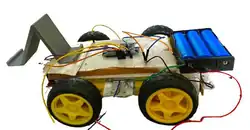

# Robotic Car (Object Detection)



**Bachelor's electrical/electronic engineering project (2023–2024)**  
**Repository maintainer:** Ilyes Dinedane  
**Supervisor:** Mrs. Mouhouche Faiza  
**Institution:** University of M'Hamed Bougara Boumerdes / IGEE, Algeria

## Project overview

A four-wheel prototype combining **Bluetooth remote movement control** and **phone-camera object detection**:

- **ESP32-WROOM-32** with Bluetooth Classic (Serial Port Profile) for movement commands;
- **L298N dual H-bridge** motor driver and four DC geared motors (left and right motor groups);
- A smartphone IP Webcam video stream processed on a computer using **OpenCV DNN** and the SSD MobileNet v3 COCO detector;
- Object labels and bounding boxes shown on the video stream.

The project report describes successful Bluetooth movement and object identification using an IP webcam. **It does not supply code proving autonomous obstacle-avoidance steering, and the Python detector and ESP32 motor controller are separate in the documented implementation.**

## Original documents and reconstructed code

The original source files were misplaced. This repository was **reconstructed from the academic project report and poster**, including code listings on report pages 23–27 and the hardware figure on page 20. It is **not** a bit-for-bit recovery of the original Arduino or Python files. Modifications and assumptions are documented in [source notes](docs/SOURCE_NOTES.md).

| Path | What it contains |
|---|---|
| [`firmware/esp32_bluetooth_car/esp32_bluetooth_car.ino`](firmware/esp32_bluetooth_car/esp32_bluetooth_car.ino) | Reconstructed Bluetooth motion-control sketch; safer stop-on-timeout and explicit motor directions |
| [`vision/object_detection.py`](vision/object_detection.py) | Reconstructed OpenCV SSD MobileNet v3 inference script, parameterized for an IP webcam |
| [`vision/requirements.txt`](vision/requirements.txt) | Python dependency |
| [`models/README.md`](models/README.md) | Required external detection model/COCO label files; not included |
| [`docs/HARDWARE_WIRING.md`](docs/HARDWARE_WIRING.md) | Documented ESP32 GPIOs, motor driver, batteries, and enable-pin uncertainty |
| [`docs/PROJECT_STATUS.md`](docs/PROJECT_STATUS.md) | Verified report claims vs. missing functionality |
| [`docs/SOURCE_NOTES.md`](docs/SOURCE_NOTES.md) | Provenance, authorship, and reconstruction differences |
| [`assets/robot_car_photo.png`](assets/robot_car_photo.png) | Original project prototype photo extracted from the project report |

## System architecture

```text
  Mobile Bluetooth controller                   Smartphone with IP Webcam
               |                                           |
       Bluetooth Classic SPP                            Wi-Fi
               |                                           |
          ESP32-WROOM-32                                  PC
               |                                   Python + OpenCV DNN
         L298N H-bridge                              COCO object labels
               |
      Left / right DC motor groups
               |
            4 wheels
```

The camera-processing computer and the ESP32 are **not automatically linked** by the recovered code. The project has two demonstrated subsystems: remote-controlled movement and visual detection.

## Getting started: Bluetooth-controlled car

1. Use an ESP32-WROOM-32 board with **Bluetooth Classic** (not an ESP32-C3/S3 board that lacks Classic SPP support).
2. Open [`firmware/esp32_bluetooth_car/esp32_bluetooth_car.ino`](firmware/esp32_bluetooth_car/esp32_bluetooth_car.ino) in Arduino IDE with the ESP32 board support installed.
3. Connect the four documented direction pins to the L298N. See [wiring notes](docs/HARDWARE_WIRING.md) and **verify your motor wiring before enabling power**.
4. Leave the L298N **ENA/ENB jumpers** fitted for constant-speed testing, or configure their actual GPIOs in the sketch for speed control. The original report **did not specify ENA/ENB wiring**.
5. Upload the sketch, pair your phone with Bluetooth device **`RoboticCarESP32`**, and use a Bluetooth terminal/controller that sends the command characters.

| Command | Action |
|---|---|
| `F` | Forward |
| `B` | Backward |
| `L` | Left |
| `R` | Right |
| `S` | Stop |
| `0`–`9`, `q` | Adjust requested motor PWM duty (only effective if EN pins are wired/configured) |

The reconstructed sketch also stops the motors after a command timeout as a safety improvement. **This version has not been flashed to the original car or tested on the real hardware.**

## Getting started: phone-camera object detection

```bash
python -m pip install -r vision/requirements.txt
python vision/object_detection.py \
  --source 'http://PHONE_IP:8080/video' \
  --weights models/frozen_inference_graph.pb \
  --config models/ssd_mobilenet_v3_large_coco_2020_01_14.pbtxt \
  --labels models/coco.names
```

- Install/open an IP Webcam application on the phone. Replace `PHONE_IP` with the phone's current local address, and ensure the computer and phone can reach each other on the network.
- Download compatible **SSD MobileNet v3 / OpenCV DNN** network weights, graph configuration, and matching COCO class-label file into `models/`. They were **not embedded in the report or recovered**, and are deliberately not bundled.
- Use `--source 0` to test a computer webcam instead.
- Press **Q** to quit the viewer.

The original report used **0.45 detection confidence**, **320×320 input**, and a phone IP webcam. It does not document a specific original model checksum or Python environment.

## Tested vs. not tested

- **Documented historic results:** Bluetooth control of the robot; IP-camera-based object detection; Arduino IDE integration (as reported in the original project documentation).
- **Reconstructed in this repository:** Arduino motor-control sketch and Python detection script; static Python checks passed.
- **Not tested during reconstruction:** hardware upload, motor wiring, live camera stream, downloaded model compatibility, performance metrics, automated navigation.

## Academic project credit

**Repository maintainer:** Ilyes Dinedane. This was an **academic group project** supervised by **Mrs. Mouhouche Faiza**. The academic report and poster were used as source references and are **not copied into this repository**. The reconstruction does not claim sole authorship or tested functionality beyond the evidence documented above.